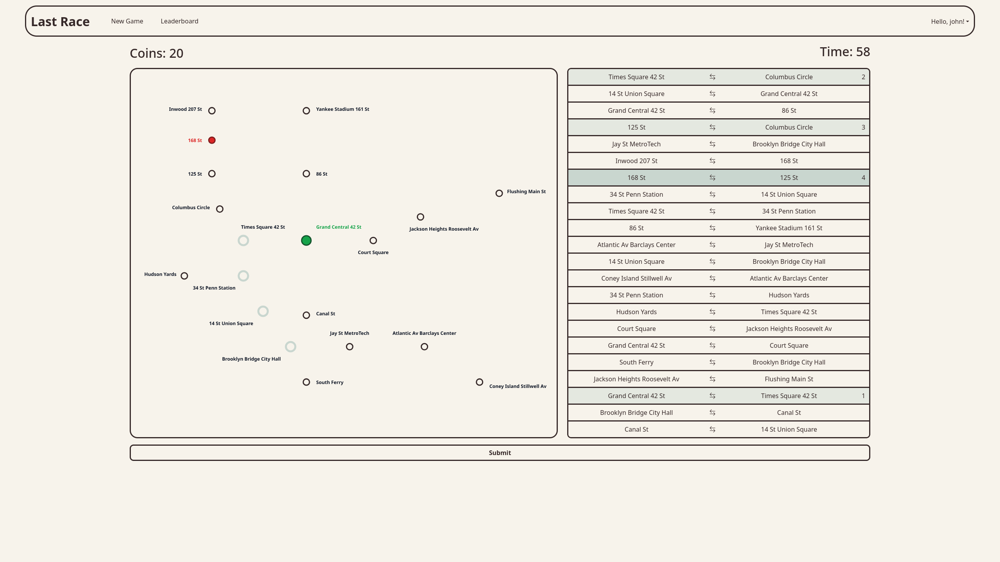
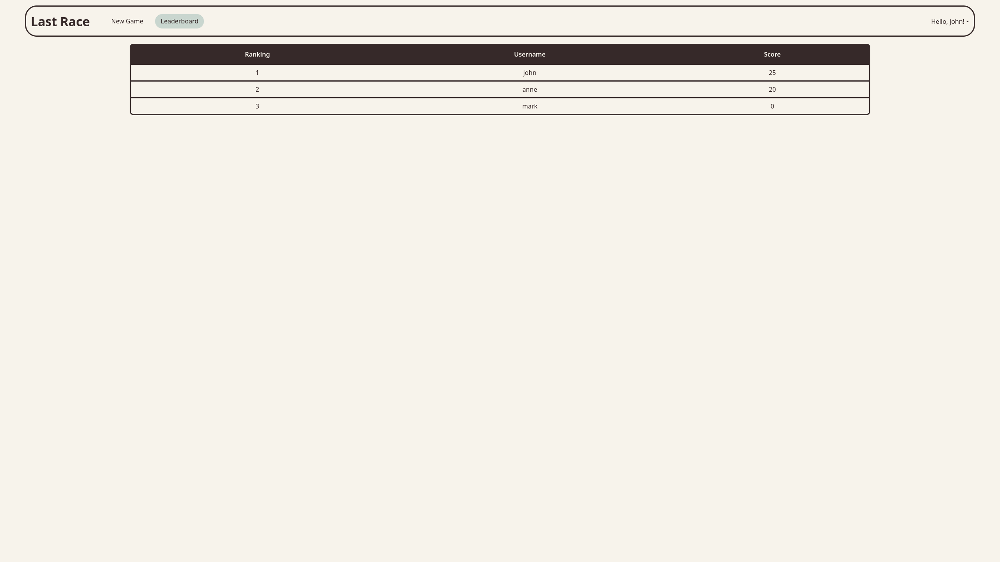

# Exam #1: "Last Race"
## Student: s361334 TAGLIAFERRI SIMONE

## React Client Application Routes

- Route `/`: homepage showing the game rules. Logged-in users also see the network map and the "Start Game" button.
- Route `/login`: login page with username and password form.
- Route `/game`: the game page. During the game the user sees the initial coins amount, a timer, the network map without the segments and the list of segments. After the user submits a list of segments, or the timer expires, a recap carousel with the network map completing the segments and the events that happened is shown.
- Route `/leaderboard`: shows the leaderboard with all users ranked by best score.

## API Server

### Authentication

#### `POST /api/sessions`
- Description: login with username and password.
- Request body:
  ```json
  { 
    "username": "john", 
    "password": "password"
  }
  ```
- Response body:
  ```json
  { 
    "userId": 1, 
    "username": "john", 
    "bestScore": 25
  }
  ```
- Status codes:
  - `201 Created`
  - `401 Unauthorized` — wrong credentials

#### `GET /api/sessions/current`
- Description: returns the currently logged-in user.
- Response body:
  ```json
  { 
    "userId": 1, 
    "username": "john", 
    "bestScore": 25 }
  ```
- Status codes:
  - `200 OK`
  - `401 Unauthorized`

#### `DELETE /api/sessions/current`
- Description: logs out the current user.
- Status codes:
  - `200 OK`

### Network Map

#### `GET /api/networkMap/stations`
- Description: returns all stations with their interchange status.
- Response body:
  ```json
  [
    { 
      "stationId": 1, 
      "name": "Central", 
      "isInterchange": true 
    },
    { 
      "stationId": 2, 
      "name": "North Gate", 
      "isInterchange": false 
    }
  ]
  ```
- Status codes:
  - `200 OK`
  - `401 Unauthorized`
  - `500 Internal Server Error`

#### `GET /api/networkMap/segments`
- Description: returns all line segments connecting pairs of stations.
- Response body:
  ```json
  [
    {
      "lineId": 1,
      "lineName": "Red Line",
      "station1Id": 1,
      "station1Name": "Central",
      "station2Id": 2,
      "station2Name": "North Gate"
    }
  ]
  ```
- Status codes:
  - `200 OK`
  - `401 Unauthorized`
  - `500 Internal Server Error`

### Game

#### `GET /api/game/start`
- Description: starts a new game. Picks a random start and end station (at least 3 segments apart) and stores them in the session to prevent cheating. It also sends the initial coins amount to the client.
- Response body:
  ```json
  { 
    "startStationId": 3, 
    "endStationId": 11, 
    "initialCoins": 20 
  }
  ```
- Status codes:
  - `200 OK`
  - `401 Unauthorized`
  - `500 Internal Server Error`

#### `POST /api/game/end`
- Description: submits the player's chosen route. It validates the route.  If valid, assigns random events to each segment and computes the final score. Updates the player's best score if beaten. It returns if the route is valid, the series of events, one for each segment, the final score and if it's a new best score. If the route is invalid it returns an empty array of events and a final score of 0, with valid and isNewBestScore set to false.
  - Request body:
  ```json
  {
    "segments": [
      {
        "station1Id": 5,
        "station2Id": 6
      },
      {
        "station1Id": 6,
        "station2Id": 8
      }
    ]
  }
  ```
    
- Response body:
  ```json
  {
    "valid": true,
    "events": [
      { 
        "eventId": 4, 
        "name": "Signal failure", 
        "description": "Delayed by 10 minutes.", 
        "effectValue": -2 
      }
    ],
    "score": 15,
    "isNewBestScore": true
  }
  ```
- Status codes:
  - `200 OK`
  - `400 Bad Request` (no active game session or malformed segments)
  - `401 Unauthorized`
  - `500 Internal Server Error`

### Leaderboard

#### `GET /api/leaderboard`
- Description: returns all players ranked by best score in descending order.
- Response body:
  ```json
  [
    { 
      "userId": 1, 
      "username": "john", 
      "bestScore": 25 
    }
  ]
  ```
- Status codes:
  - `200 OK`
  - `401 Unauthorized`
  - `500 Internal Server Error`

## Database Tables

- Table `users` - contains:
  - `user_id` - INTEGER, PK, AUTOINCREMENT
  - `username` - TEXT, UNIQUE, NOT NULL
  - `password` - TEXT, NOT NULL
  - `salt` - TEXT, NOT NULL
  - `best_score` - INTEGER, DEFAULT 0

- Table `stations` - contains:
  - `station_id` - INTEGER, PK, AUTOINCREMENT
  - `name` - TEXT, UNIQUE, NOT NULL

- Table `lines` - contains:
  - `line_id` - INTEGER, PK, AUTOINCREMENT
  - `name` - TEXT, UNIQUE, NOT NULL

- Table `line_segments` - contains:
  - `line_id` - INTEGER, FK on `lines(line_id)`
  - `station1_id` - INTEGER, FK on `stations(station_id)`
  - `station2_id` - INTEGER, FK on `stations(station_id)`
  - PK(`line_id`, `station1_id`, `station2_id`)

- Table `events` - contains:
  - `event_id` - INTEGER, PK, AUTOINCREMENT
  - `name` - TEXT, UNIQUE, NOT NULL
  - `description` - TEXT, NOT NULL
  - `effect_value` - INTEGER, NOT NULL

## Data Models

- User 
  ```js
  function User(userId, username, bestScore) {
    this.userId = userId;
    this.username = username;
    this.bestScore = bestScore;
  }
  ```

- Station
  ```js
  function Station(stationId, name, isInterchange) {
    this.stationId = stationId;
    this.name = name;
    this.isInterchange = isInterchange;
  }
  ```

- Segment
  ```js
  function Segment(lineId, lineName, station1Id, station1Name, station2Id, station2Name) {
    this.lineId = lineId;
    this.lineName = lineName;
    this.station1Id = station1Id;
    this.station1Name = station1Name;
    this.station2Id = station2Id;
    this.station2Name = station2Name;
  }
  ```

- Event
  ```js
  function Event(eventId, name, description, effectValue) {
    this.eventId = eventId;
    this.name = name;
    this.description = description;
    this.effectValue = effectValue;
  }
  ```

## Main React Components

- NetworkMap: SVG of the metro network. Accepts `showLines` to toggle the segments visibility, `highlightedSegments` to draw the player's chosen route, and `startStationId`/`endStationId` to highlight endpoints.
- SegmentList: clickable list of all segments. The player builds their route by toggling segments on and off. Each row has a swap button to flip the displayed direction.
- ResultCarousel: carousel showing the journey one segment at a time after submission, with the associated event card per step and a final summary slide.
- CountdownTimer: timer that counts down from 90 seconds. Calls `onTimeUp` when time runs out, automatically submitting the game.
- LoginForm: form component for username and password input.
- Leaderboard: table of players ranked by best score.

## Screenshot

### Gameplay



### Leaderboard



## Users Credentials

- john, password
- anne, password
- mark, password

## Use of AI Tools

Claude was used for:
- Helping develop the correct algorithm to select the proper start and end stations for a game.
- Helping define the map layout and clarifying how to use the svg component in React.
- Clarifying the concept of useRef to have the countDownTimer as a standalone components rather than having it implemented inside the GamePage itself. 
- Clarifying, fixing and debugging CSS styling for Table, Carousel and NetworkMap. I manually checked the styling and made proper adjustments manually where needed.

